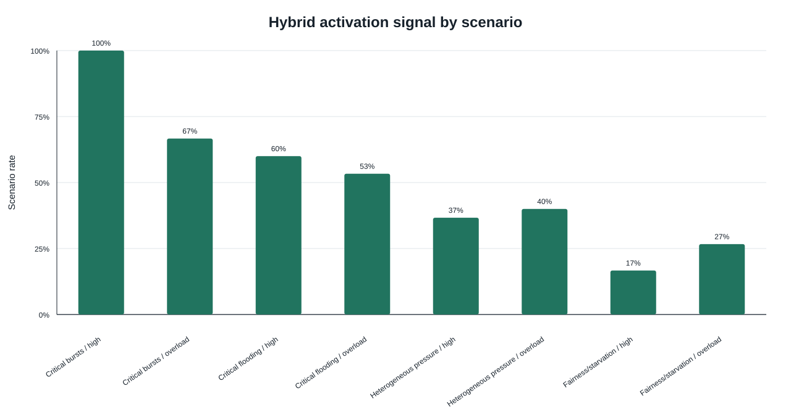
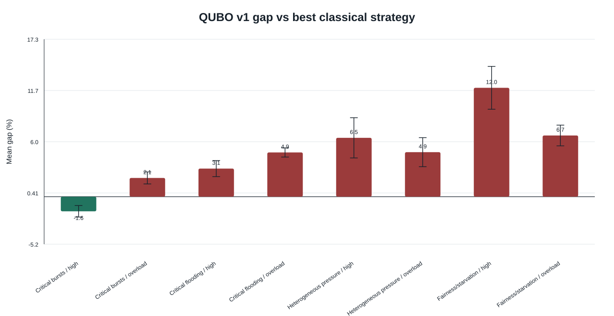
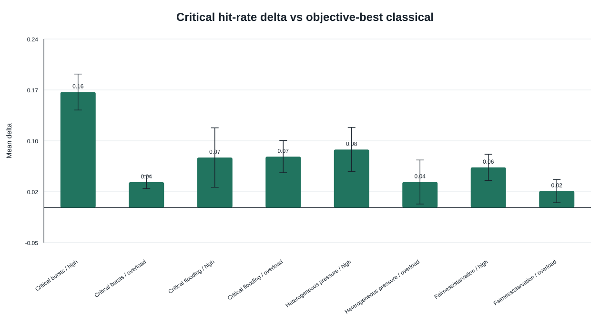
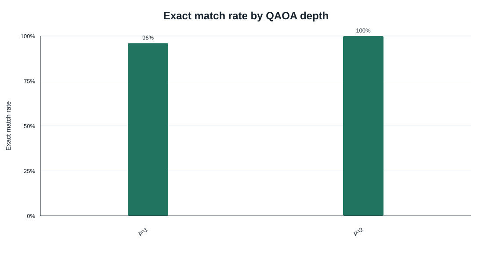

# Quantum-Inspired Event Scheduling

Experimental artifact for evaluating quantum-inspired scheduling strategies in
event-driven distributed systems.

The project models event batches, worker queues, deadlines, critical-event
priority, starvation pressure, fairness, and heterogeneous worker capacity. It
then compares classical dispatching heuristics against exact QUBO batch
optimizers, with small-instance QAOA validation through Qiskit.

The goal is deliberately modest:

```text
Can QUBO-based scheduling act as a useful specialist optimizer in selected
multi-objective pressure windows?
```

The experiments do not claim scalable quantum advantage. They support a hybrid
interpretation: classical heuristics remain the default path, while QUBO-based
optimization can be activated for selected high-pressure windows.

## What Is In This Repository

- Elixir/Docker simulator for event-driven scheduling scenarios.
- Classical scheduling baselines.
- Exact QUBO batch strategies used as quantum-inspired optimizers.
- Python analysis scripts for processed tables and SVG figures.
- Qiskit/QAOA validation for small exported QUBO instances.
- Curated raw and processed experiment outputs.
- English and Spanish Livebooks for reproducible result inspection.

## Headline Result

The broad experiment shows that QUBO v1 is not a universal replacement for
classical heuristics. The targeted stress experiment shows a stronger and more
useful pattern: QUBO v1 becomes competitive in scenarios where several
operational pressures overlap.

In the targeted stress matrix:

| Metric | Result |
| --- | ---: |
| Paired comparisons | 240 |
| QUBO v1 wins vs best classical objective baseline | 44/240 |
| QUBO v1 within 5% of the best classical objective baseline | 147/240 |
| QUBO v1 improves over QUBO v0 | 167/240 |
| Hybrid activation signal | 120/240 |

The strongest case was `burst_critical/high`:

| Metric | Result |
| --- | ---: |
| QUBO v1 objective win rate | 90% |
| QUBO v1 within 5% of best classical | 100% |
| Hybrid activation signal | 100% |
| Mean objective gap vs best classical | -1.61% |
| Mean improvement vs QUBO v0 | 17.35% |
| Critical-deadline hit-rate delta | +0.1649 |

The main negative result is also useful: `fairness_starvation` does not favor
the current QUBO formulation as an objective-cost strategy. This bounds the
claim and keeps the architecture argument realistic.

## Key Figures

### Hybrid Activation Signal

This chart marks the profile/load groups where QUBO v1 looks plausible as a
specialist optimizer.



### Objective Gap Against The Best Classical Baseline

Negative values mean QUBO v1 outperformed the best classical strategy under the
shared objective function.



### Critical Deadline Hit-Rate Delta

QUBO v1 often trades global latency for better protection of critical events.
This figure shows that effect directly.



### QAOA Small-Instance Validation

QAOA is used here as a validation layer for tiny exported QUBO instances, not as
a scalability claim.



## Repository Layout

```text
code/event_scheduler_sim/     Elixir simulator and scheduling strategies
analysis/                     Python analysis and QAOA validation scripts
scripts/                      Reproducible Bash and PowerShell commands
notebooks/livebook/           English and Spanish Livebooks
results/raw/                  Curated raw experiment outputs
results/processed/            Processed CSV summaries
results/figures/              Generated SVG figures
```

## Run The Simulator

Build the Docker image:

```bash
docker build -t quantum-inspired-event-scheduling-sim ./code/event_scheduler_sim
```

PowerShell equivalent:

```powershell
docker build -t quantum-inspired-event-scheduling-sim .\code\event_scheduler_sim
```

Run tests:

```bash
docker run --rm -v "${PWD}:/workspace" -w /workspace/code/event_scheduler_sim quantum-inspired-event-scheduling-sim mix test
```

Run the targeted stress matrix:

```bash
bash scripts/run_targeted_stress_matrix.sh
```

Windows PowerShell equivalent:

```powershell
.\scripts\run_targeted_stress_matrix.ps1
```

Process targeted results:

```bash
bash scripts/run_targeted_stress_analysis.sh
```

Windows PowerShell equivalent:

```powershell
.\scripts\run_targeted_stress_analysis.ps1
```

## Open The Livebooks

Start Livebook with Docker:

```bash
docker run --rm -p 8080:8080 -v "${PWD}:/workspace" ghcr.io/livebook-dev/livebook:latest
```

Then open:

```text
http://localhost:8080
```

Available notebooks:

- `/workspace/notebooks/livebook/results_exploration_en.livemd`
- `/workspace/notebooks/livebook/results_exploration_es.livemd`

The Livebooks render summary tables from the checked-in result files, so they
can be used as a lightweight result browser without extra visualization dependencies.

## Reproduce Processed Outputs

```bash
bash scripts/run_extended_event_driven_matrix.sh
bash scripts/run_qaoa_validation_analysis.sh
bash scripts/run_targeted_stress_matrix.sh
bash scripts/run_targeted_stress_analysis.sh
```

Windows PowerShell equivalents:

```powershell
.\scripts\run_extended_event_driven_matrix.ps1
.\scripts\run_qaoa_validation_analysis.ps1
.\scripts\run_targeted_stress_matrix.ps1
.\scripts\run_targeted_stress_analysis.ps1
```

The QAOA validation dependencies are isolated in:

```text
analysis/qaoa_validation/
```

## Interpretation Boundary

This artifact supports an experimental, quantum-inspired scheduling study. It
does not demonstrate scalable quantum advantage and should not be interpreted as
a production scheduler.

The intended interpretation is a hybrid architecture:

- classical heuristics as the default low-latency path;
- QUBO-based optimization for selected high-pressure windows;
- QAOA as small-instance validation of the QUBO-to-quantum-optimizer path.
